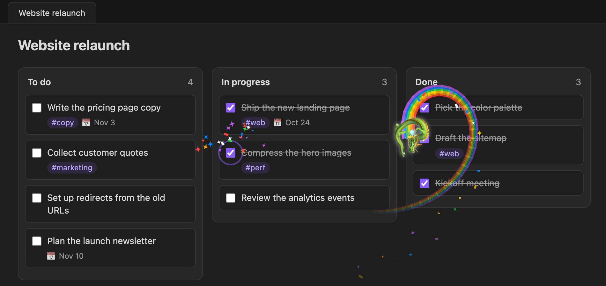

# Obsidian Kando Plugin

Create markdown-backed Kanban boards in [Obsidian](https://obsidian.md/).

This is a personal fork/continuation of [obsidian-community/obsidian-kanban](https://github.com/obsidian-community/obsidian-kanban) (originally created by [mgmeyers](https://github.com/mgmeyers)), rebased on the latest toolchain (Bun, TypeScript 7, Preact 11, strict null checks, all dependencies current) with a Vitest suite covering the markdown parser, drag and drop, and the table view.

Bugs, issues and feature requests go to the [issue tracker](https://github.com/moritosh/obsidian-kando/issues).



With **Celebrate completions** turned on in the plugin settings, completing a card (by checking it off or moving it to a "Done" list) bursts sparkles from it, and now and then a creature launches from the card and swoops across the board on a rainbow trail, sometimes turning a loop on the way.

## Installing

This plugin isn't in the community plugin store. To install it:

1. Download `obsidian-kando-<version>.zip` from the [latest release](https://github.com/moritosh/obsidian-kando/releases/latest).
2. Unzip it into your vault's `.obsidian/plugins/` folder, so the files end up in `.obsidian/plugins/obsidian-kando/`.
3. Reload Obsidian and enable **Kando** under Settings → Community plugins.

Each release also carries `main.js`, `manifest.json` and `styles.css` as separate files, so [BRAT](https://github.com/TfTHacker/obsidian42-brat) can install and update the plugin from this repository too. That is the easiest way onto a phone or tablet, where unzipping into the vault is awkward; while the repository is private, BRAT needs a GitHub personal access token with read access to it. Alternatively, install the plugin on a computer and let your vault sync carry `.obsidian/plugins/obsidian-kando/` over.

To run your own build instead, copy (or symlink) `build/obsidian-kando/` from `bun run build` into the plugins folder.

## Development

Requires [Bun](https://bun.sh/) (this repo doesn't use npm/yarn/pnpm, and Node isn't needed). The expected version is recorded in the `packageManager` field.

```sh
bun install        # install dependencies
bun run dev        # esbuild in watch mode
bun run build      # production build -> build/obsidian-kando/
bun run typecheck  # tsc --noemit
bun run test       # run the Vitest suite (not `bun test`, which is Bun's own test runner)
bun run prettier   # format src/
```

GitHub Actions runs the type check, tests and build on every push to `main` and on pull requests.

Dependencies are pinned to exact versions — no `^` or `~` ranges — and `bun.lock` is committed. `bunfig.toml` sets `install.exact = true`, so `bun add <pkg>` pins automatically. To move a dependency, bump it deliberately (`bun update <pkg> --latest`) and commit the lockfile with it.

## Release

Add the changes under `### Unreleased` in the changelog below, commit, then run `bun run release <version>` on a clean `main`. It sets the version in `package.json`, `manifest.json` and `versions.json`, renames the changelog section to that version, commits, and pushes a tag like `1.2.0` (no `v`, since Obsidian matches tags to the manifest version). The `release` workflow then builds the plugin and publishes a GitHub release with the zip, the three plugin files, and that changelog section as its notes.

## Changelog

### 1.2.2

- Updated dependencies, including Preact 11.1.0.

### 1.2.1

- Cards on mobile have the same rounded corners as on desktop. They had turned into pills, because they took the radius Obsidian gives text inputs, which is touch-sized on mobile.

### 1.2.0

- Switched the toolchain to [Bun](https://bun.sh/) for installing dependencies and running scripts; Node is no longer needed. Dependencies are pinned to exact versions.
- Migrated to Preact 11 and `@tanstack/react-table` 9, and updated all other dependencies.
- Reworked the **Celebrate completions** animation: it now starts from the completed card, with a sparkle burst every time and, now and then, a creature that faces the way it flies and swoops off on a curved rainbow trail, sometimes looping the loop. It is drawn on a single canvas that is removed afterwards, and it is skipped when the system asks for reduced motion.
- Releases are now built and published by GitHub Actions; `bun run release <version>` cuts one. Install from the release zip.
- Removed ESLint, which no longer ran: typescript-eslint doesn't support TypeScript 7. Type checking (`bun run typecheck`) and Prettier remain.
- Replaced the vendored `buffer` polyfill and the custom esbuild plugins with the `buffer` npm package and a small inline plugin, and dropped unused dependencies.
- Extended the Vitest suite to cover the table view (sorting, search, column resizing and saved widths) and the drag-and-drop components.

### 1.1.0

- Added an optional **Celebrate completions** setting: checking off a card, or moving it to a list named (or explicitly marked as) "Done", has a chance to send a random creature (unicorn, dragon, otter, whale, or flamingo) flying across the screen with a rainbow trail. Off by default; enable it in the plugin settings or per-board.
- Trimmed several small runtime dependencies (`classcat`, `is-plain-object`, `deepmerge`, `react-fast-compare`, `animated-scroll-to`, and a few others) in favor of inlined implementations, shrinking the plugin's bundle.
- Enabled `noImplicitOverride` and hardened external card links to only follow `http(s)` URLs.

### 1.0.0

- Initial release of this fork: rebranded as obsidian-kando, rebased on the current TypeScript/toolchain with strict null checks, and added a Vitest suite covering the markdown parser and drag-and-drop data layer.

## License

GNU GPLv3 (or later) — see [LICENSE.md](./LICENSE.md). This is a derivative work of [obsidian-community/obsidian-kanban](https://github.com/obsidian-community/obsidian-kanban), also GPLv3.
